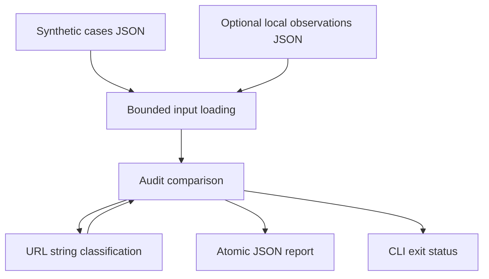

# URLPolicy Lab 1.0.1

**Offline defensive QA for outbound webhook URL policies, using Python's standard library.**

This portfolio project makes a small security workflow inspectable: parse untrusted
local inputs, classify URL strings conservatively, compare synthetic application
decisions, and produce a reproducible JSON report. It never sends requests or
resolves DNS. It is not a vulnerability scanner or a production SSRF prevention library.

## Problem and solution

Applications that accept webhook URLs need an explicit destination policy.
Malformed authorities, unusual numeric hosts, local IP literals and URL parser
differences make that policy difficult to test. A string check cannot establish
where a real HTTP client will connect.

URLPolicy Lab provides 17 illustrative fixtures and a reference classification:

| Classification | Meaning |
| --- | --- |
| `BLOCK` | Rejected by this illustrative policy; the reason is included. |
| `REVIEW_DNS` | A hostname requires separate DNS and connection-time checks. |
| `ALLOW_LITERAL` | A literal is global and non-multicast according to the running Python version; no connection was tested. |

An optional local observation file records `BLOCK`, `ALLOW`, `SKIPPED` or `REVIEW`
from another test harness. URLPolicy does not execute or integrate with that application.

## Competencies represented by the repository

| Area | Inspectable evidence |
| --- | --- |
| Application Security | Explicit input policy, parser ambiguity handling, threat boundaries and documented uncertainty. |
| Defensive security research | Synthetic reproductions, fixed regressions, an integer-mask IPv4 oracle and separation of observations from conclusions. |
| Python security engineering | Bounded JSON reads, schema/type checks, duplicate-key rejection, controlled errors and atomic output. |
| Security automation | Machine-readable decisions, CLI exit semantics and repeatable local test/fuzz runners. |

These are portfolio artifacts, not evidence of paid client work, undisclosed
vulnerability discoveries or an independently certified security product.
Preparation and validation used Codex assistance; see [provenance](docs/PROVENANCE.md).

## Architecture



The production code remains one module. Tests, examples, documentation and
validation tooling are separate; no service, database or external package is needed.
See [architecture and decisions](docs/ARCHITECTURE.md).

## Run on Linux

Use an existing Python installation. No package installation or Internet access
is required. Source syntax requires Python 3.10+; the recorded validation is on
**Linux x86_64 / CPython 3.12.3 only**. Other interpreter versions are unverified.

The project is included in the [portfolio repository](https://github.com/vincimech010233/vincimech010233/tree/main/ciberseguridad/urlpolicy-lab).
After downloading the portfolio, enter `ciberseguridad/urlpolicy-lab`.
From that project directory:

```bash
python3 --version
mkdir -p build
python3 -B urlpolicy_lab.py examples/cases.json \
  --observed examples/observed_demo.json --output build/demo_report.json
cmp examples/demo_report.json build/demo_report.json
```

The example observations are fabricated fixtures, not results from a real target.
Global IP addresses appearing in examples are numeric test strings; they are
never contacted. The expected summary is `PASS=16, FAIL=0, WARN=1, UNTESTED=0`,
recorded in `examples/demo_report.json`.
With the recorded interpreter, `cmp` verifies byte-for-byte reproduction.

Without observations, cases are `UNTESTED`:

```bash
python3 -B urlpolicy_lab.py examples/cases.json --output build/unobserved.json
```

`--allow-http` permits the HTTP scheme in the reference policy; other rejection
rules still apply.

| Exit code | Meaning |
| --- | --- |
| `0` | No hard comparison failures; **WARN and UNTESTED may still exist**. |
| `1` | At least one reference `BLOCK` case was observed as `ALLOW`. |
| `2` | Invalid input or a handled filesystem error. |

Read the JSON summary, rather than equating exit code 0 with complete validation.

## Tests and bounded fuzzing

Portable functional reproduction from the repository directory:

```bash
python3 -B -m unittest discover -s tests -v
python3 -B tools/fuzz.py
```

The suite contains **38 unittest methods**: 15 baseline tests, 15 audit regressions
and 8 critical-review regressions. Its subcases are not counted as separate tests.
It includes:

- malformed authorities, IPv4/IPv6 cases and the documented verdict matrix;
- JSON types, duplicate keys/IDs, UTF-8, byte/count/URL limits and nested JSON;
- CLI exit behavior, output symlink rejection and atomic-write failure cleanup;
- a separate integer-mask oracle for 600 addresses in six explicit IPv4 ranges;
- 1,000 generated DNS-authority metamorphic cases, without DNS resolution;
- 10,000 generated strings, seed `20261011`, checking stability and determinism.

`tools/fuzz.py` repeats the same seeded generation as a standalone run and reports
an input-stream SHA-256. It is not an additional set of 10,000 unique security
oracle cases. It checks exceptions, label validity, determinism and reason types,
not semantic correctness against all URL parsers.

### Recorded results

Fresh portfolio validation results are in [validation evidence](evidence/validation.json)
and the [test log](evidence/tests.log). Earlier Codex-assisted audit results are
identified separately in [source provenance](evidence/source-provenance.json);
they are not substituted for the portfolio rerun.

| Fresh local run, 2026-10-11 | Result |
| --- | --- |
| Linux x86_64 / CPython 3.12.3 | 38 tests passed; 0 failures/errors/skips |
| Standalone seed `20261011` | 10,000 inputs, 20,000 classification calls |
| Fuzz classifications | 9,980 BLOCK; 20 REVIEW_DNS; 0 ALLOW_LITERAL |
| README example | Byte-identical reproduction; 16 PASS and 1 WARN |
| Traced functional runs | No network syscalls after the guard's seccomp filter was loaded |

The random-string corpus is heavily rejection-biased and did not exercise the
ALLOW_LITERAL branch; fixed positive tests cover selected global literals.
Neither run establishes exhaustive coverage.

The optional strict reproduction runner requires existing Linux x86_64 tools
`bwrap`, `strace`, `prlimit`, `timeout` and `libseccomp.so.2`. It installs nothing:

```bash
python3 -I -S tools/offline_audit.py
```

It verifies isolation before importing project code, copies the repository into
a temporary directory, and preserves fresh evidence there. It stops with
`BLOCKED` if isolation cannot be established. The ordinary test commands above
do not establish that kernel isolation. See [reproduction details](docs/REPRODUCIBILITY.md).

## Design and security boundaries

- Reference-policy classification is separated from application observations.
- Hostnames remain `REVIEW_DNS`; no hostname is declared safe after string parsing.
- Input files are bounded to 1 MiB, cases to 512, IDs to 80 ASCII characters;
  `classify` rejects strings longer than 4,096 characters.
- JSON duplicate keys and ambiguous authorities are rejected explicitly.
- Output uses a temporary file and atomic replacement in a caller-chosen directory.
  The output parent must be trusted; this is not a filesystem sandbox.

## Limitations and threat model

The tool does not test actual DNS rebinding, redirects, connection pinning, client
parser equivalence, proxies, TLS certificates, egress controls or real exploitability.
Python IP classifications may change between releases. An application that
blocks every case can pass; availability and false positives are not measured.
The classifier is an illustrative policy, not a universal URI-validity oracle.

No coverage percentage, absence-of-vulnerabilities guarantee or independent
external audit is claimed. The separate implementer and critic used the same
model and shared environment. See [threat model](docs/THREAT_MODEL.md) and
[critical review](docs/CRITICAL_REVIEW.md).

## Possible future work

Only after a concrete need is established: a Python-version validation matrix,
functional acceptance cases for false-positive measurement, or an adapter to an
owner-authorized application's own test decisions. These are unimplemented ideas,
not current capabilities. Production networking remains outside this project's scope.

## License and publication

The source includes the [MIT license](LICENSE), with its existing contributors
copyright notice retained. Contribution provenance and publication authority are
tracked in [provenance](docs/PROVENANCE.md) and the [publication checklist](docs/PUBLICATION.md).
The owner has declared MIT publication permission and authorized inclusion in the
existing portfolio. No exclusive ownership, affiliation or external certification
is implied. A private reporting channel is still pending; see [security policy](SECURITY.md).
